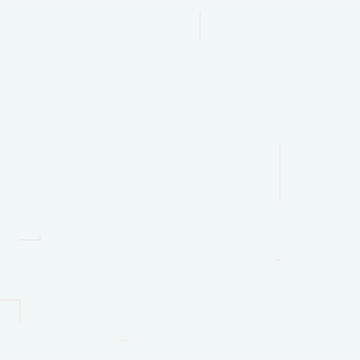
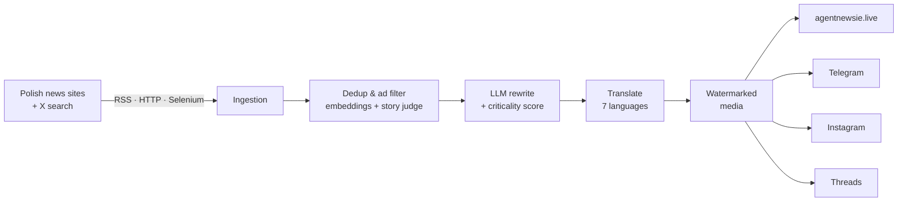

# Agent Newsie

### *News written by machines, read by humans.*

A fully automated newsroom for people living in Poland. 
It reads the Polish press around the clock, rewrites every story with AI and publishes it in **7 languages**, on the web and on social media.

---

<table>
<tr>
<td width="55%" valign="top">

### Why Agent Newsie?

Living abroad means missing the news that matters to you: a new tax rule, a strike, a storm warning, a change at the immigration office. Local news is in Polish, and it is spread across dozens of sites.

Agent Newsie fixes that:

- 🕵️ **Reads for you:** watches Polish news sites and X 24/7
- ✍️ **Rewrites:** an LLM turns each story into a short, clear summary
- 🚨 **Ranks:** every story gets a criticality score, so breaking news goes first
- 🧹 **Filters:** duplicates, ads and repeat topics are dropped before they reach you
- 🌍 **Translates:** Polish, English, Turkish, Azerbaijani, Kazakh, Kyrgyz and Uzbek
- 📣 **Publishes:** to the website, Telegram, Instagram and Threads, with branded images
- 📅 **Events:** a local events page next to the news

</td>
<td width="45%" align="center" valign="middle">

</td>
</tr>
</table>

## ⚙️ How it works

## 📢 Advertise with Agent Newsie

Reach a multilingual community living in Poland, on the website and across social channels.

| 1. Design | 2. Pay | 3. Review | 4. Live |
|---|---|---|---|
| Pick your placements and preview your ad on every channel. | Secure checkout with Stripe. | Our team checks every ad before it runs. | Your ad appears on the site and goes out on social. |

Formats: website banner, social posts, reels and stories, booked by the day for up to 7 days, starting **from 7 PLN**.

## 🛠️ Under the hood

  
  
  
  
  
  
  
  

- **Python pipeline** built on Strategy + Factory: every fetcher, parser, LLM provider and publisher is a plug-in
- **LLM cascade:** Anthropic Claude, Google Gemini and Groq, with OpenAI moderation
- **Semantic dedup** with FastEmbed embeddings, a story judge and topic cooldowns
- **Next.js** public site, operator dashboard and self-serve advertiser flow
- Runs **24/7 on a Raspberry Pi** (ARM, CPU-only, Docker)

---

This repository is the public home of Agent Newsie: updates and feedback. The source code is private.

Found a bug or want to suggest a news source? <a href="../../issues">Open an issue</a>.

Built by <a href="https://github.com/bbuyukyuksel">Burak Büyükyüksel</a>.

